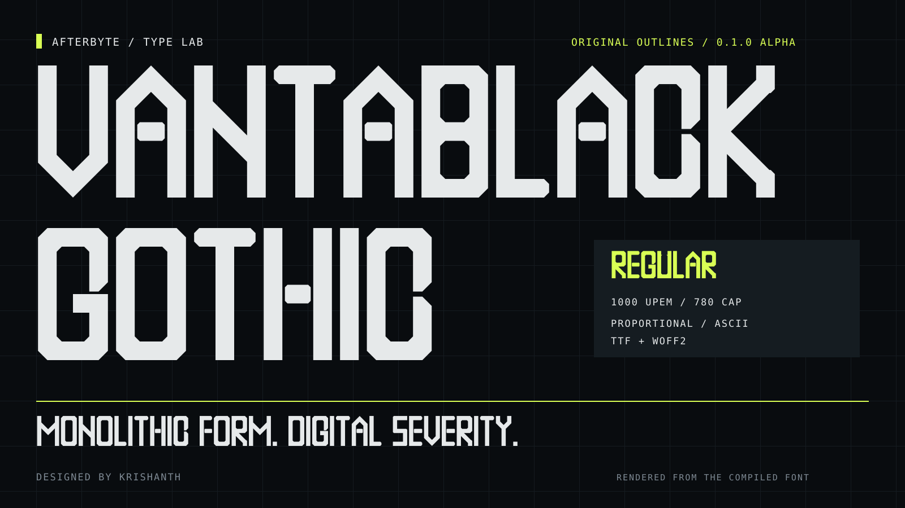
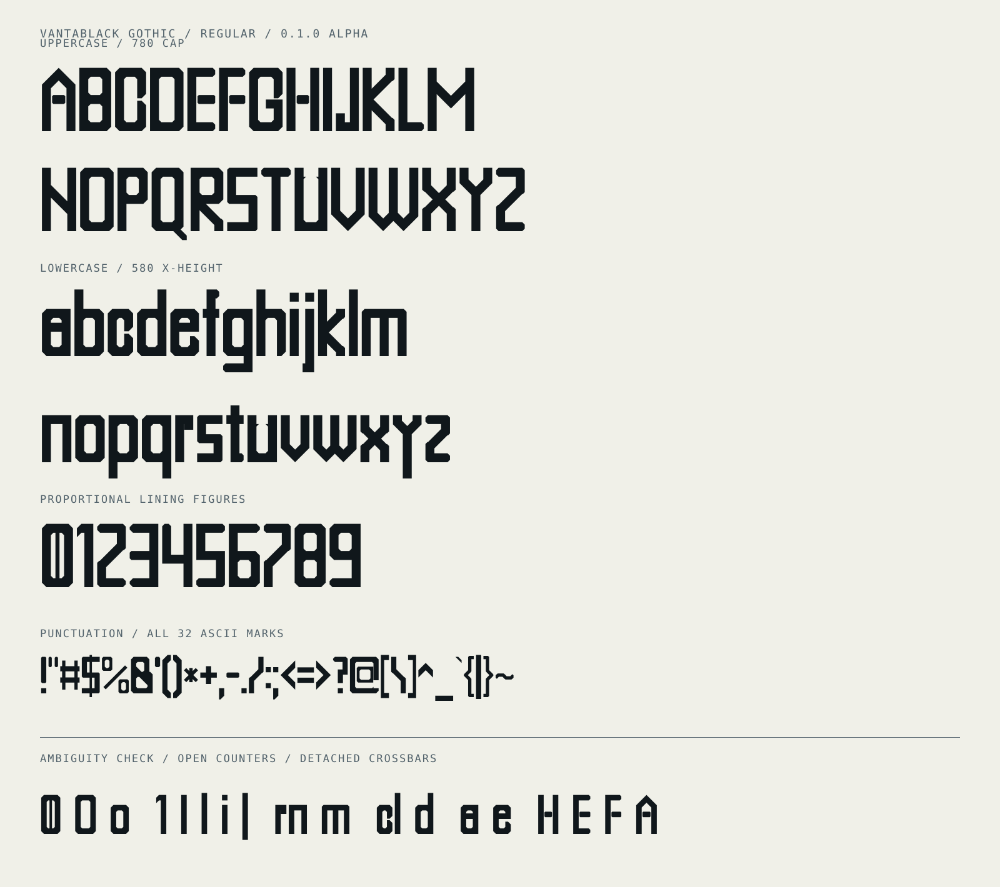

<div align="center">



# Vantablack Gothic

**Monolithic form. Digital severity.**

An original, angular, hyper-condensed proportional display typeface by **[Krishanth](https://github.com/krishanth7)**.


**[Download TTF](https://github.com/krishanth7/afterbyte-mono/raw/refs/heads/main/fonts/vantablack-gothic/VantablackGothic-Regular.ttf)** · **[Download WOFF2](https://github.com/krishanth7/afterbyte-mono/raw/refs/heads/main/fonts/vantablack-gothic/VantablackGothic-Regular.woff2)** · [Design specification](docs/vantablack-gothic/SPECIFICATION.md) · [Editable outlines](sources/vantablack-gothic/glyphs.json)

</div>

## The latest font in this repository

Vantablack Gothic turns letters into tall architectural masses: heavy beams, octagonal bowls, hard 45° cuts, tight spacing, and detached crossbars. It is designed for expressive headlines, fictional aerospace telemetry, industrial identities, and sci-fi HUD art direction.

**Regular 0.1.0 alpha is available now:** 95 printable ASCII characters plus a visible missing-glyph symbol, in installable TTF and web-ready WOFF2 formats. Both are built from original polygon recipes; no third-party font outlines are included.

The repository keeps its original `afterbyte-mono` address. **Vantablack Gothic is proportional**, while the earlier [Afterbyte Mono concept](docs/DESIGN.md) remains a separate, unbuilt pixel monospace study.

## See the actual typeface

The hero and specimen images below contain paths extracted from the compiled Vantablack Gothic font. They do not substitute a system font for the display lettering. GitHub README text itself uses GitHub's fonts; custom fonts cannot be applied to the Markdown body.

<picture>
  <source media="(prefers-color-scheme: dark)" srcset="assets/vantablack-gothic/glyphs-dark.svg">
  
</picture>

Text equivalents for accessible inspection and testing:

```text
ABCDEFGHIJKLMNOPQRSTUVWXYZ
abcdefghijklmnopqrstuvwxyz
0123456789
!"#$%&'()*+,-./:;<=>?@[\]^_`{|}~
0 O o  1 I l i |  rn m  cl d  a e  H E F A
```

## Font style

| Property | Current alpha |
| --- | --- |
| Family / style | Vantablack Gothic / Regular |
| Classification | Proportional condensed display sans |
| Em scale | 1000 UPEM |
| Cap / x-height | 780 / 580 units |
| Ascender / descender | 820 / −200 units |
| Structural stems | 110 units |
| Default side bearings | 24 units |
| Detached crossbar gaps | 15 units |
| Outlines | Integer-coordinate polygons; axis and 45° edges |
| Coverage | U+0020–U+007E; 95 printable ASCII characters |
| Files | TTF, WOFF2, CSS, editable polygon JSON |
| License | MIT, including the original font binaries and sources |

**Signature forms:** octagonal O, a 45° Q tail, a centered vertical bar in zero, a flagged 1, sharp V/W apexes, and floating E/F/H/A crossbars.

## Install and use

**Desktop:** download the TTF, open it in your operating system's font viewer, and choose Install. Select **Vantablack Gothic — Regular** in your design application. Installation behavior has not been audited across operating systems.

**Web:** copy the [font directory](fonts/vantablack-gothic) into your project. Its [CSS file](fonts/vantablack-gothic/vantablack-gothic.css) loads WOFF2 with TTF fallback:

```css
@font-face {
  font-family: "Vantablack Gothic";
  src: url("./VantablackGothic-Regular.woff2") format("woff2"),
       url("./VantablackGothic-Regular.ttf") format("truetype");
  font-style: normal;
  font-weight: 400;
  font-display: swap;
}

.display-title {
  font-family: "Vantablack Gothic", sans-serif;
  font-size: clamp(5rem, 12vw, 15rem);
  font-weight: 400;
  line-height: 1.05;
  letter-spacing: 0;
}
```

The relative URLs resolve from your CSS file's location. Serve fonts with your own website; do not use GitHub's raw-file URL as a production font CDN.

## Alpha scope and limitations

This is a working first alpha, with room for optical refinement. Use it at display sizes; start around 80 px and inspect the actual layout. A 15-unit gap is only 0.72 px at 48 px, so fine details may disappear at smaller sizes.

- No hinting, shipped kerning, ligatures, additional weights, or variable-font axes.
- No accented Latin, Telugu, German umlauts, smart quotes, rupee sign, or other extended Unicode glyphs yet. Supply a fallback font.
- No completed cross-platform installation audit, independent font certification, or accessibility conformance audit.
- Use a conventional readable face for body copy, instructions, errors, and critical information.

See the [alpha design decisions](docs/vantablack-gothic/ALPHA.md) and [accessibility guidance](ACCESSIBILITY.md).

## Rebuild from original sources

Use Python 3.12 in an isolated environment:

```sh
python -m venv .venv
# Activate your environment, then:
python -m pip install -r requirements-font.txt
python tools/build_vantablack.py
python tools/validate_vantablack_spec.py
python tools/validate_vantablack_font.py
```

The default build regenerates [glyphs.json](sources/vantablack-gothic/glyphs.json) from the original Python geometry recipes and [system.json](docs/vantablack-gothic/system.json). To compile manually edited polygon sources without overwriting them:

```sh
python tools/build_vantablack.py --from-source
python tools/validate_vantablack_font.py
```

To regenerate the README specimens, run `python tools/render_vantablack.py`. This optional renderer uses DejaVu Sans Mono for metadata labels and requires that system font at the documented Linux path; all display lettering comes from the compiled Vantablack TTF.

## Validation

Local checks cover ASCII coverage, original source/binary agreement, contour winding and topology, integer coordinates and exact edge directions, side bearings, line metrics, license metadata, TTF/WOFF2 outline equivalence, HarfBuzz shaping, and FreeType raster smoke checks at 32/48/64/80/120/240 px. The build produces [SHA-256 checksums](fonts/vantablack-gothic/SHA256SUMS).

Passing these checks does not establish small-text readability or universal platform support. The [automated workflow](.github/workflows/specification.yml) rebuilds and checks the font and design contract.

## Explore and contribute

[Four-part specification](docs/vantablack-gothic/SPECIFICATION.md) · [Alpha notes](docs/vantablack-gothic/ALPHA.md) · [Roadmap](ROADMAP.md) · [Changelog](CHANGELOG.md) · [Source guide](sources/README.md)

[Contributing](CONTRIBUTING.md) · [Code of conduct](CODE_OF_CONDUCT.md) · [Security policy](SECURITY.md) · [Accessibility](ACCESSIBILITY.md) · [Issue templates](https://github.com/krishanth7/afterbyte-mono/issues/new/choose) · [Pull request template](.github/pull_request_template.md)

## License and authorship

Copyright © 2026 Krishanth. The original Vantablack Gothic outlines, binaries, geometry recipes, artwork, and documentation are released under the **[MIT License](LICENSE)**. The font directory includes a copy, and the font's metadata contains the license text. Third-party build dependencies retain their own licenses.

[Departure Mono](https://github.com/rektdeckard/departure-mono) informed the earlier pixel-font category discussion. Vantablack Gothic uses its own proportional polygon design and is not a renamed or modified Departure Mono font. This project is independent and does not claim endorsement or affiliation with any similarly named product.

---

<div align="center">
<strong>Vantablack Gothic / Regular / 0.1.0 alpha</strong><br>
Designed by Krishanth. Built from original geometry.
</div>
