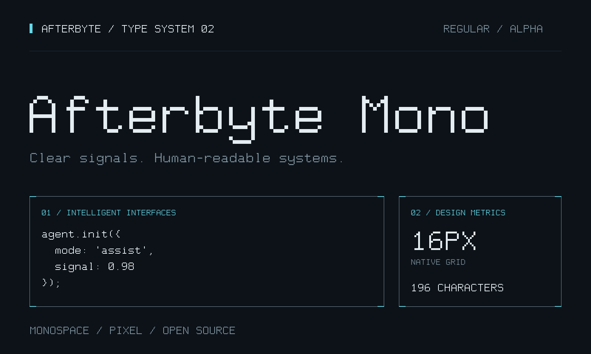
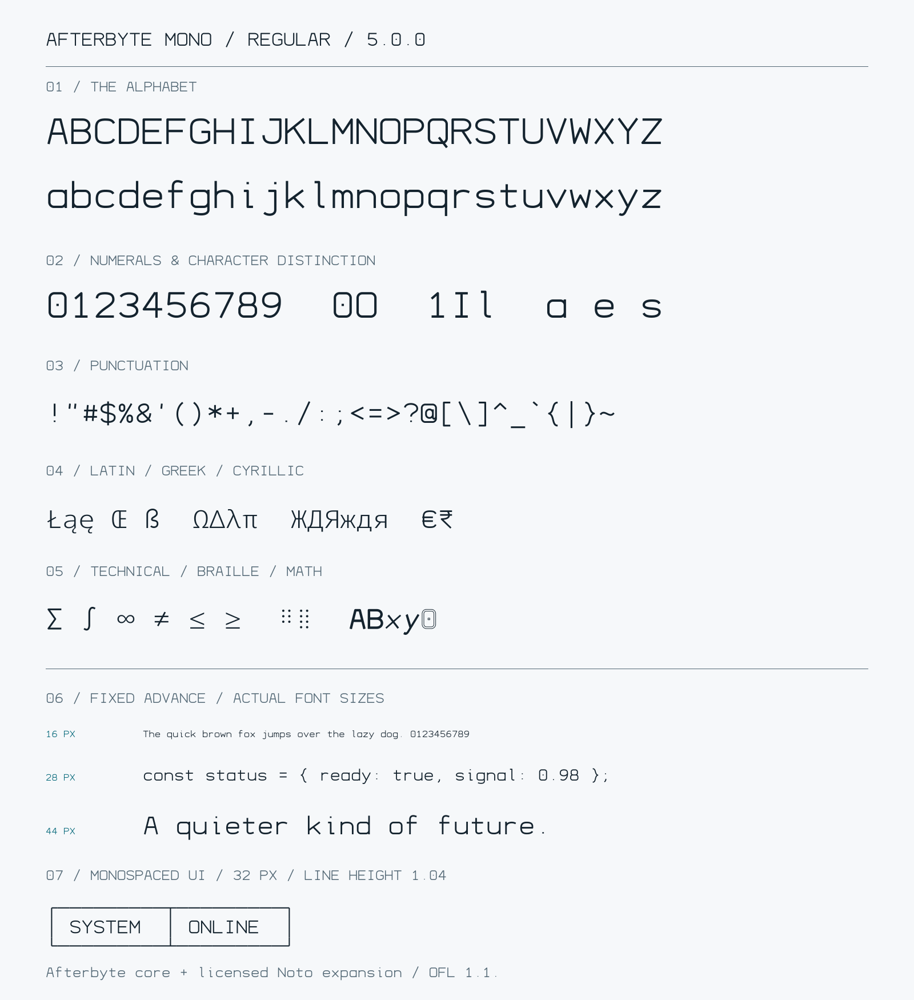

<div align="center">



# Afterbyte Mono

**An independent technical monospace with a corporate character.**


[](https://github.com/krishanth7/afterbyte-mono/actions/workflows/specification.yml)
[](LICENSE)

**[Download TTF](https://github.com/krishanth7/afterbyte-mono/raw/refs/heads/main/fonts/afterbyte-mono/AfterbyteMono-Regular.ttf)** · **[Download WOFF2](https://github.com/krishanth7/afterbyte-mono/raw/refs/heads/main/fonts/afterbyte-mono/AfterbyteMono-Regular.woff2)** · [Specimen](#specimen) · [Usage](#usage) · [Design provenance](docs/PROVENANCE.md)

</div>

## Overview

Afterbyte Mono is a continuous-vector typeface for software products, technical dashboards, code samples, and measured digital identities. Rounded bowls, open forms, a consistent monolinear rhythm, and equal character advances combine a restrained futuristic character with practical typography.

Version **0.3.0 alpha** establishes a new design direction. The earlier pixel construction has been replaced with original vector centerlines and a different metric system. This is a substantive glyph redesign, not a renamed font or a cosmetic change to the old specimen.

Maintained by [Krishanth](https://github.com/krishanth7). Current build: **Regular · 196 Unicode mappings · TTF + WOFF2**.

## Signature forms

| Detail | Current design |
| --- | --- |
| A | Flat upper bridge with long diagonal legs |
| 0 | Centered dot inside a rounded rectangular bowl |
| a / g | Single-storey forms with a clear open-descender construction |
| O / o | Continuous rounded bowls instead of pixel steps |
| R / Q | Curved upper chambers and deliberate diagonal exits |
| 1 / I / l | Distinct flag, bars, and asymmetric terminal treatment |
| Spacing | Equal 650-unit advance for every glyph |

The design specifications and source coordinates are documented in [DESIGN.md](docs/DESIGN.md) and [vectors.json](sources/afterbyte-mono/vectors.json).

## Specimen

<picture>
  <source media="(prefers-color-scheme: dark)" srcset="assets/afterbyte-mono/specimen-dark.svg">
  
</picture>

All specimen lettering is extracted from the compiled font and rendered as SVG glyph paths. GitHub uses its own typography for the surrounding README text.

```text
ABCDEFGHIJKLMNOPQRSTUVWXYZ
abcdefghijklmnopqrstuvwxyz
0123456789   0O   1Il   a e g
ÄÖÜ äöü ß   ÀÉÎÑ   æ ø   € £ ¥ ₹
← → ↑ ↓ ↔ ↕   ✓ ■ □
```

[Proofing text](specimen/afterbyte-mono.txt) · [Exact Unicode coverage](fonts/afterbyte-mono/coverage.txt) · [Validation notes](docs/QUALITY.md)

## Downloads

| File | Purpose |
| --- | --- |
| [AfterbyteMono-Regular.ttf](https://github.com/krishanth7/afterbyte-mono/raw/refs/heads/main/fonts/afterbyte-mono/AfterbyteMono-Regular.ttf) | Desktop applications, editors, and local installation |
| [AfterbyteMono-Regular.woff2](https://github.com/krishanth7/afterbyte-mono/raw/refs/heads/main/fonts/afterbyte-mono/AfterbyteMono-Regular.woff2) | Self-hosted websites and applications |
| [afterbyte-mono.css](fonts/afterbyte-mono/afterbyte-mono.css) | Font-face declaration |
| [SHA256SUMS](fonts/afterbyte-mono/SHA256SUMS) | Binary integrity |
| [vectors.json](sources/afterbyte-mono/vectors.json) | Editable vector centerline source |

These links point to the current alpha on `main`. No tagged stable release or package-manager distribution is claimed.

## Usage

### Desktop

Download the TTF, open it in your system's font viewer, and choose Install. Select **Afterbyte Mono — Regular**.

If an earlier version is cached, replace or uninstall it and restart the application. Version 0.3 changes the design, advance, and vertical metrics, so existing layouts may reflow.

### Web

Copy the [font directory](fonts/afterbyte-mono) into your project and load:

```css
@font-face {
  font-family: "Afterbyte Mono";
  src: url("./AfterbyteMono-Regular.woff2") format("woff2"),
       url("./AfterbyteMono-Regular.ttf") format("truetype");
  font-weight: 400;
  font-style: normal;
  font-display: swap;
}

.technical-text {
  font-family: "Afterbyte Mono", monospace;
  font-size: 16px;
  font-weight: 400;
  line-height: 1.5;
  letter-spacing: 0;
  font-synthesis: none;
}
```

The font has continuous outlines and does not require pixel-size multiples. Local raster smoke checks cover 12, 16, 24, 32, 48, and 96 px; inspect readability in your actual application.

For connected box-drawing rows, use `line-height: 1.04` and `letter-spacing: 0`. For normal text, allow more vertical space. Resolve font URLs relative to your CSS file and self-host the binaries.

## Technical profile

| Property | Value |
| --- | --- |
| Family / style | Afterbyte Mono / Regular |
| Spacing | True monospace; 650 units |
| Em / construction | 1000 UPEM / continuous vector centerlines |
| Structural stroke | 64 units |
| Cap / x-height | 700 / 500 units |
| Typographic ascender / descender | 820 / −220 units |
| Coverage | 196 Unicode mappings + .notdef |
| Formats | TTF, WOFF2, CSS |
| Project source/binary license | MIT |

Coverage includes printable ASCII, selected accented Latin, German umlauts and ß, Æ/æ and Ø/ø, €, £, ¥ and ₹, typographic punctuation, arrows, status symbols, box drawing, and stylized stripe/block symbols. It is not complete Latin-1 or universal script support.

## Development

Use Python 3.12 and the pinned dependencies:

```sh
python -m venv .venv
# Activate the environment before installing dependencies.
python -m pip install -r requirements-font.txt

python tools/draw_afterbyte_vector.py
python tools/build_afterbyte.py
python tools/validate_afterbyte.py
python tools/render_afterbyte.py
```

The editable source is [vectors.json](sources/afterbyte-mono/vectors.json). Running the vector recipe generator overwrites direct JSON edits; run only the build when compiling a manually edited source.

The compiler samples original cubic centerlines, expands their strokes, unions the geometry, and writes integer polygon outlines. TTF and WOFF2 are built from the same data with fixed timestamps. It does not load another font, trace its outlines, or convert the old pixel matrices.

[Design specification](docs/DESIGN.md) · [Provenance record](docs/PROVENANCE.md) · [Roadmap](ROADMAP.md) · [Changelog](CHANGELOG.md)

## Quality and scope

Checks cover source-to-binary outline agreement, valid contour topology, fixed advances, names, line metrics, signature glyphs, embedded license text, TTF/WOFF2 equivalence, HarfBuzz shaping, raster smoke checks, checksums, links, and reproducible builds.

This is an alpha with one Regular style, selected Unicode coverage, no variable axes, no ligatures, and no bytecode hinting. Cross-platform installation, multiple browser engines, independent font validation, and additional language coverage remain open work. Technical checks are not a readability certification or legal clearance.

## Contributing

Include the font version, text sample, application, OS, size, zoom/display scale, and optional screenshot in rendering reports. Original glyph proposals and real product examples are welcome.

[Contributing](CONTRIBUTING.md) · [Issue forms](https://github.com/krishanth7/afterbyte-mono/issues/new/choose) · [PR template](.github/pull_request_template.md)

[Code of conduct](CODE_OF_CONDUCT.md) · [Security policy](SECURITY.md) · [Accessibility](ACCESSIBILITY.md)

## License and provenance

Original project sources, binaries, artwork, and documentation are distributed under the **[MIT License](LICENSE)**. Build dependencies retain their own licenses.

The previous 0.2 pixel experiment referenced Departure Mono as an aesthetic category. Version 0.3 uses a separate continuous-vector design. Its glyph coordinates were developed for this project with AI assistance; no Departure Mono font binaries, glyph outlines, source matrices, or artwork are included or read by the current build.

The [provenance record](docs/PROVENANCE.md) documents inputs and design changes. It does not certify copyright status, trademark clearance, or absence of third-party claims. This project is independent and makes no affiliation claim.

---

<div align="center">
Afterbyte Mono · Clarity with a distinct character.
</div>
