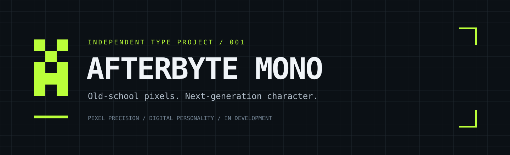

# Afterbyte Mono

**Old-school pixels. Next-generation character.**

An independent pixel monospace typeface project for code, terminals, and digital interfaces.

[Design direction](docs/DESIGN.md) · [Roadmap](ROADMAP.md) · [Contribute](CONTRIBUTING.md) · [Request a glyph](https://github.com/krishanth7/afterbyte-mono/issues/new/choose)

## A new character for the digital world

Afterbyte Mono explores the precision of a pixel grid with the personality of early computer interfaces. The aim is a recognizable typeface that works in developer tools, creative coding, game interfaces, and expressive digital identities.

Created and maintained by [Krishanth](https://github.com/krishanth7).

> **Project status:** Initial project setup. This repository currently contains the identity, design brief, specimen text, contribution process, and release plan. Font outlines, installable font files, and a build pipeline have not been implemented. The banner uses a system font and is a branding graphic, not a sample of the finished typeface.

## Design goals

- **Pixel-first construction:** consistent grid geometry and intentional stepped curves.
- **True monospace:** a shared advance width across supported spacing glyphs.
- **Readable character shapes:** distinguish `0 O`, `1 I l`, and punctuation at small sizes.
- **Code-friendly rhythm:** balanced brackets, operators, numerals, and spacing.
- **Independent identity:** original glyph drawings and metrics.

These are design targets, not implemented features.

## Planned first release

| Area | Target |
| --- | --- |
| Family | Afterbyte Mono |
| Initial style | Regular |
| Initial coverage | Printable ASCII, U+0020–U+007E |
| Desktop format | TTF |
| Web format | WOFF2 |
| Source | Editable glyph sources and documented build process |
| Quality | Coverage, metrics, naming, and rendering checks |

Extended Latin, currency symbols, box drawing, additional weights, and ligatures are future proposals. No release date is committed.

## Explore the project

| Location | Purpose |
| --- | --- |
| [Design brief](docs/DESIGN.md) | Grid, metrics, identity, and readability requirements |
| [Specimen text](specimen/sample.txt) | Character coverage and visual proofing text |
| [Sources](sources/README.md) | Source contribution expectations |
| [Font output](fonts/README.md) | Planned output formats and release requirements |
| [Roadmap](ROADMAP.md) | Milestones and acceptance criteria |
| [Contributing](CONTRIBUTING.md) | How to propose, review, and validate changes |
| [Changelog](CHANGELOG.md) | Project history |

## Get involved

Open an issue with a concrete glyph request, a design proposal, or a rendering example. For glyph proposals, include the Unicode code point, intended use, a grid drawing, and a side-by-side readability comparison.

Please discuss large design changes before implementation. See [CONTRIBUTING.md](CONTRIBUTING.md).

## Inspiration and provenance

[Departure Mono](https://github.com/rektdeckard/departure-mono) is a reference for the general pixel monospace category. Afterbyte Mono is an independent project and is not affiliated with or endorsed by Departure Mono. No upstream font files, outlines, source code, or artwork are included.

## License

Current original repository documentation, code, and artwork are covered by the [MIT License](LICENSE). There are no font binaries or glyph outlines in this initial repository. A dedicated font license will be selected and included before any font assets are accepted or released; that decision must be documented explicitly.

---

Built by Krishanth · Designed one pixel at a time.

